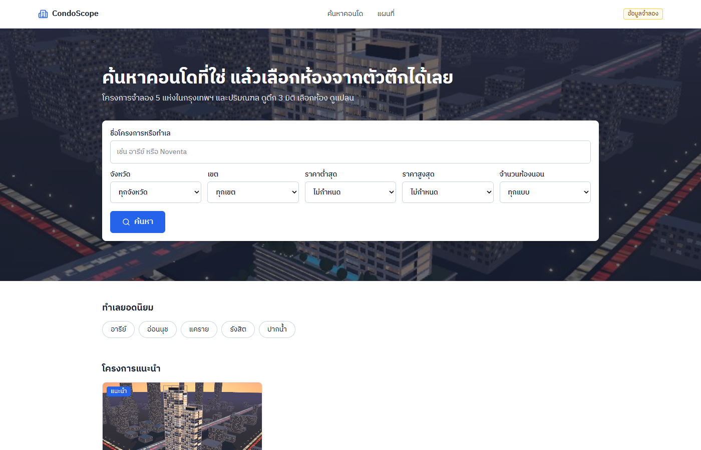
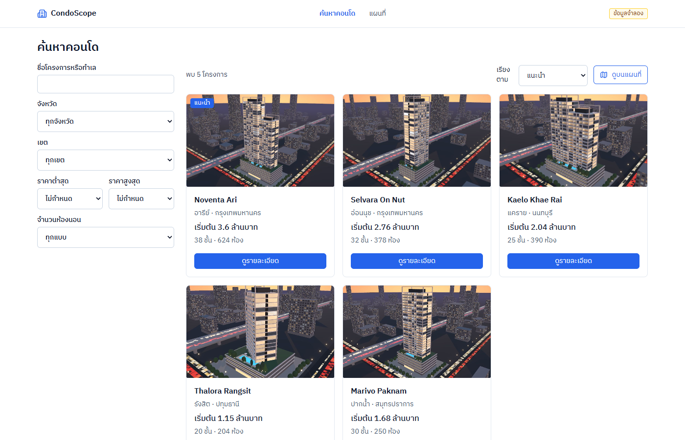
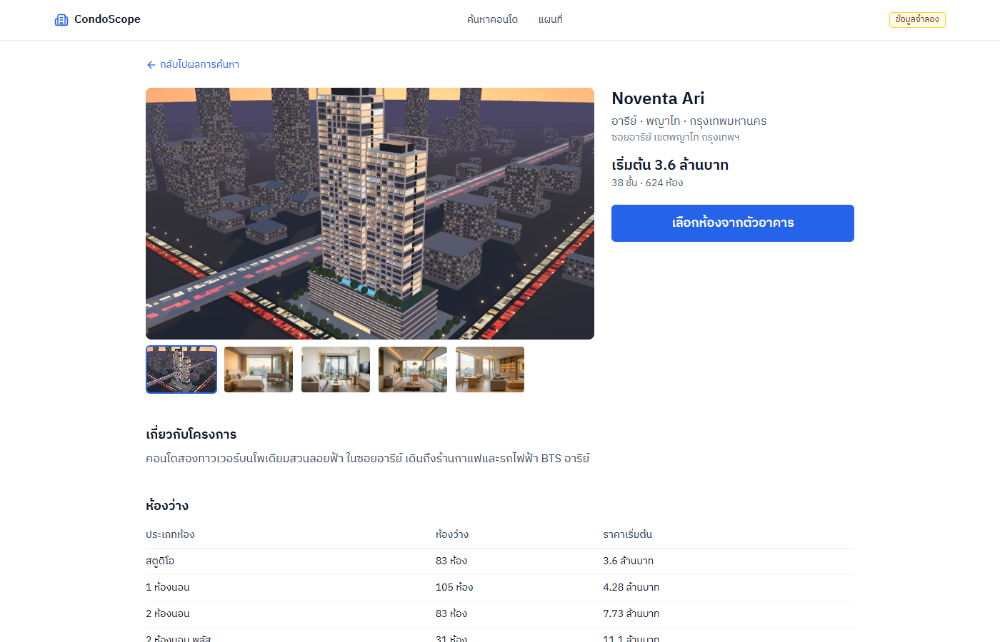
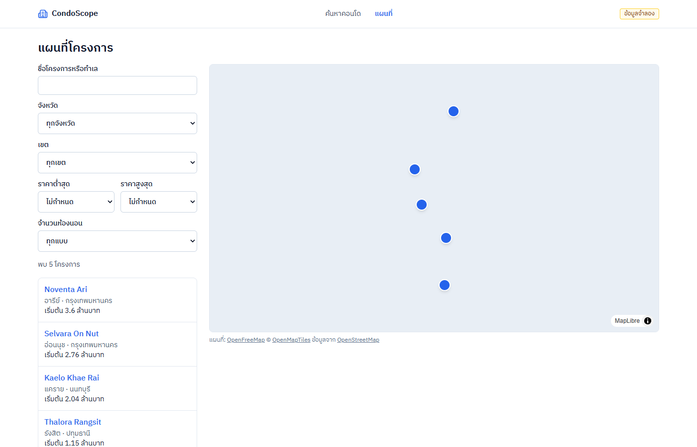
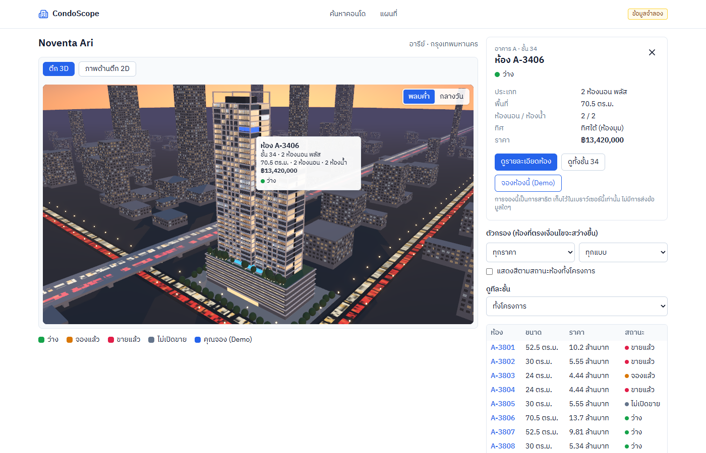
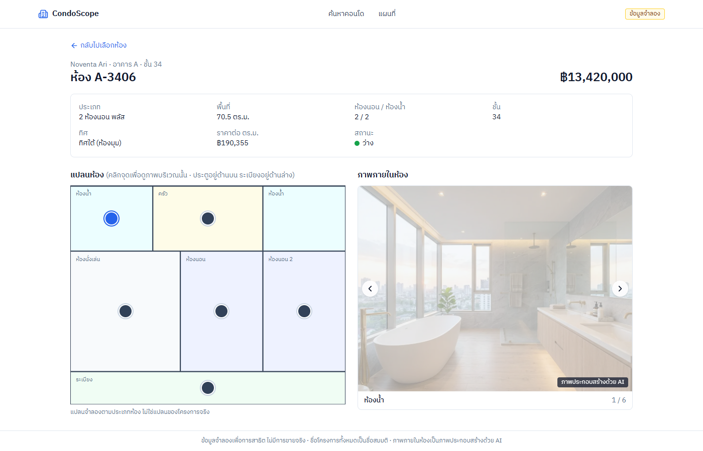

# CondoScope

เว็บค้นหาและเลือกซื้อคอนโด (ข้อมูลจำลอง) สำหรับ portfolio จุดเด่นคือ **Building Explorer 3D** ที่ให้เลือกห้องจากตัวตึกได้โดยตรง

> **ข้อมูลจำลองเพื่อการสาธิต ไม่มีการขายจริง** ชื่อโครงการทั้งหมดเป็นชื่อสมมติ ภาพภายในห้องเป็นภาพประกอบสร้างด้วย AI และแปลนเป็นแปลนจำลองตามประเภทห้อง ไม่ใช่ของโครงการจริง

**ลิงก์เดโม:** ยังไม่ deploy

## ภาพรวม

ผู้ใช้เริ่มจากหน้าค้นหา เลือกโครงการ แล้วเข้าสู่ตึก 3D เพื่อคลิกห้องที่ต้องการ ดูราคา สถานะ แปลน และภาพภายในห้อง มีโครงการจำลอง 5 แห่ง รวม 1,846 ห้อง

## ฟีเจอร์

- ค้นหาโครงการตามชื่อ ทำเล จังหวัด เขต ช่วงราคา จำนวนห้องนอน และเรียงลำดับ (ตัวกรองอยู่ใน URL แชร์ลิงก์ได้)
- Building Explorer 3D: คลิกห้องบนตัวตึก ผ่าดูทีละชั้น กรองห้อง สลับพลบค่ำ/กลางวัน หมุนกล้องไปหาห้องที่เลือกจากรายการ และมีภาพตึก SVG สำรองเมื่อเครื่องไม่มี WebGL
- หน้ารายละเอียดห้อง: แปลนพร้อมจุด hotspot กดดูภาพภายในแต่ละจุด
- แผนที่กรุงเทพฯ ปักหมุดโครงการ (OpenFreeMap) สลับเป็นรายการได้
- จองห้องแบบจำลอง เก็บในเบราว์เซอร์เท่านั้น ไม่ส่งข้อมูลไปไหน
- เมื่อ API ใช้ไม่ได้ เว็บใช้ข้อมูลสำรองและแสดงแบนเนอร์ **Demo Fallback Mode** ชัดเจน (ไม่แสดงข้อมูลสำรองว่าเป็นข้อมูลจริง)
- เข้าถึงได้ด้วยคีย์บอร์ดและ screen reader (ตรวจด้วย axe ใน e2e) และใช้งานบนมือถือได้

## Tech stack

React 19 · Vite · TypeScript · Tailwind CSS · React Three Fiber (three.js) · MapLibre + OpenFreeMap · React Router (HashRouter) · Hono + zod บน Cloudflare Workers · Cloudflare D1 (SQLite) · GitHub Pages + GitHub Actions · Vitest · Playwright (+ axe)

ทุกอย่างใช้ free tier และ open source งบ 0 บาท ไม่ต้องผูกบัตร

## สถาปัตยกรรม

แผนภาพ ตาราง endpoint เส้นทางของเว็บ กติกา error/CORS/แคช งบ bundle และ workflow ของ CI อยู่ใน [`docs/architecture.md`](docs/architecture.md)

## การออกแบบฐานข้อมูล

แผนภาพ ER และรายละเอียดตารางอยู่ในหัวข้อ "ฐานข้อมูล" ของ [`docs/architecture.md`](docs/architecture.md) (migration: [`database/migrations/`](database/migrations/))

## การติดตั้งและรันในเครื่อง

ต้องมี Node.js 24 (ไม่ต้องมีบัญชี Cloudflare)

```bash
npm install
npm run db:reset      # สร้างฐานข้อมูล D1 ในเครื่องและใส่ข้อมูลจำลอง
npm run api:dev       # API ที่ http://localhost:8788
echo "VITE_API_URL=http://localhost:8788" > apps/web/.env.local
npm run dev -w web    # เว็บ (ไม่มี .env.local = ใช้ข้อมูลสำรอง)
```

คำสั่งอื่น

```bash
npm test              # Vitest: shared + api + web
npm run typecheck
npm run build -w web && npm run check:bundles -w web
npm run e2e           # Playwright (ต้องติดตั้ง: npx playwright install chromium)
npm run screenshots   # ถ่ายภาพหน้าจอใหม่ใน docs/screenshots/
```

## Deploy

เว็บขึ้น GitHub Pages ส่วน API และฐานข้อมูลอยู่บน Cloudflare (Workers + D1) ผ่าน GitHub Actions ต้องตั้งค่าใน repo ดังนี้

1. Secrets: `CLOUDFLARE_API_TOKEN` (สิทธิ์แก้ Workers และ D1) และ `CLOUDFLARE_ACCOUNT_ID`
2. สร้างฐานข้อมูล `wrangler d1 create condoscope` แล้วใส่ `database_id` ใน `apps/api/wrangler.jsonc`
3. หลัง deploy API ครั้งแรก ตั้ง variable `VITE_API_URL` เป็นที่อยู่ `*.workers.dev`
4. เปิด GitHub Pages โดยเลือก source = GitHub Actions
5. รัน workflow `seed-db` หนึ่งครั้ง (พิมพ์ `SEED`) เขียนราว 12,000 แถว ฟรีวันละ 100,000 แถว จึงไม่ควรรันซ้ำหลายรอบ
6. ตรวจด้วย `node scripts/smoke-live.mjs <URL ของ API>`

## ภาพหน้าจอ

| หน้าแรก | ผลค้นหา |
|---|---|
|  |  |

| โครงการ | แผนที่ (ภาพนี้ใช้พื้นหลังแผนที่แบบเรียบ เพื่อไม่ขึ้นกับอินเทอร์เน็ต) |
|---|---|
|  |  |

| Building Explorer 3D | รายละเอียดห้อง |
|---|---|
|  |  |

## ข้อความข้อมูลจำลอง

ข้อมูลโครงการ ราคา สถานะห้อง และแปลนทั้งหมดสร้างจากโปรแกรมสร้างข้อมูลจำลอง (deterministic) ไม่มีโครงการหรือชื่อจริง ไม่มีการขายจริง ภาพภายในห้องสร้างด้วย AI และมีป้ายกำกับในเว็บ แผนที่ใช้ข้อมูลจาก OpenStreetMap ผ่าน OpenFreeMap

## เอกสารอื่น

- สเปกการออกแบบ: [`docs/specs/2026-11-09-condoscope-design.md`](docs/specs/2026-11-09-condoscope-design.md)
- ต้นแบบตึก 3D: [`prototype/building-3d/`](prototype/building-3d/)

## บทบาทของฉันและการใช้ AI

<!-- TODO (เจ้าของโปรเจกต์เขียนเอง): อธิบายด้วยคำของตัวเองว่าคุณทำอะไร ตัดสินใจอะไร และใช้ AI ช่วยตรงไหน -->
