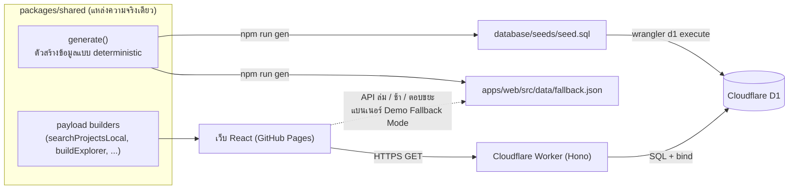
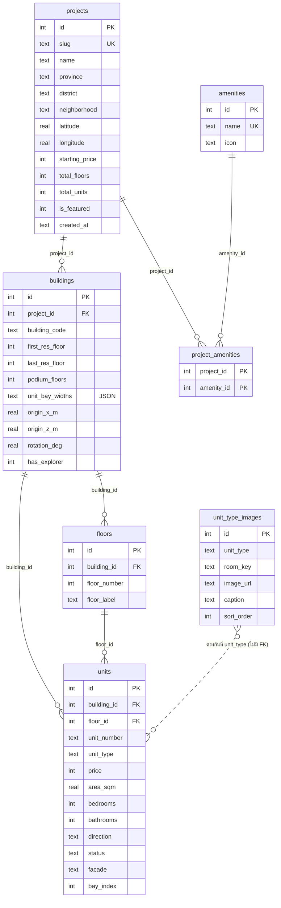

# สถาปัตยกรรม CondoScope

เอกสารนี้รวมเรื่องฐานข้อมูล API หน้าเว็บ และการ deploy ไว้ไฟล์เดียว (สเปกข้อ 13.3)
ข้อมูลทั้งหมดเป็นข้อมูลจำลอง ไม่มีการขายจริง

## ภาพรวม



- เว็บเรียก API ก่อนเสมอ (ตั้ง `VITE_API_URL`) ถ้า API ล่ม ช้าเกิน 5 วินาที ตอบ 5xx ตอบหน้า HTML หรือ JSON เสีย จะใช้ `fallback.json` ผ่าน payload builders ชุดเดียวกับที่เป็น "เฉลย" ของ API test และขึ้นแบนเนอร์ **Demo Fallback Mode** ทุกครั้ง
- API ตอบ 400/404 ในรูปแบบ error ของ API เองเท่านั้นที่เว็บถือว่า "ไม่พบข้อมูล" (ไม่ fallback)
- ถ้าไม่ตั้ง `VITE_API_URL` เว็บใช้ข้อมูลสำรองเสมอ และไม่เรียก API เลย

## ฐานข้อมูล (D1, `database/migrations/0001_init.sql`)



- ข้อจำกัดที่สำคัญ: `UNIQUE(building_id, floor_id, facade, bay_index)` (ห้องไม่ซ้ำตำแหน่ง), `UNIQUE(building_id, unit_number)`, CHECK ของ `status`, `facade`, `area_sqm > 0`, `price > 0`, `json_valid(unit_bay_widths)`, foreign key ทุกตัว (D1 บังคับให้)
- **`units.unit_type` ไม่มี CHECK โดยตั้งใจ** เพื่อให้เพิ่มประเภทห้องใหม่ (penthouse/duplex/full-floor ในสเปกข้อ 14) ได้โดยไม่ต้องสร้างตารางใหม่
- Index: `idx_projects_province_price`, `idx_units_building_floor`, `idx_units_building_status`
- ภาพภายในห้องผูกกับ "ประเภทห้อง" ไม่ใช่รายห้อง (สเปกข้อ 13.1) และแปลนห้องไม่เก็บในฐานข้อมูล: คำนวณจากเทมเพลตใน `packages/shared/src/floorplan.ts`

## API (Hono บน Cloudflare Workers, อ่านอย่างเดียว)

ตอบเป็นข้อมูลตรงๆ ไม่ห่อด้วย `{ data }` ชนิดข้อมูลทั้งหมดอยู่ใน `packages/shared/src/types.ts`

| Method + path | ผลลัพธ์ | หมายเหตุ |
|---|---|---|
| `GET /api/health` | `{ ok, db }` | ไม่แคช; DB พัง → 503 |
| `GET /api/projects` | `ProjectPage` | `q`, `province`, `district`, `minPrice`, `maxPrice`, `bedrooms` (0/1/2), `sort`, `limit` (1–50), `offset` |
| `GET /api/projects/:id` | `ProjectDetailPayload` | ตึก, สิ่งอำนวยความสะดวก, จำนวนห้องว่างและราคาต่ำสุดแยกประเภท |
| `GET /api/projects/:id/buildings` | `Building[]` | |
| `GET /api/projects/:id/explorer` | `ExplorerPayload` | รูปทรงตึก + ห้องทั้งหมดของโครงการ **ใน request เดียว** |
| `GET /api/buildings/:id/floors` | `Floor[]` | ชั้นมาก→น้อย |
| `GET /api/buildings/:id/units` | `UnitView[]` | `floor`, `status` ถ้าไม่เจอ → `[]` (200) |
| `GET /api/units/:id` | `UnitDetailPayload` | |
| `GET /api/units/:id/images` | `UnitTypeImage[]` | ตามประเภทห้อง |
| `GET /api/units/:id/floor-plan` | `UnitFloorPlanPayload` | |

กติกาการค้นหา `/api/projects` (SQL และ `searchProjectsLocal` ของ fallback ต้องให้ผลเหมือนกัน มี test เทียบทุกเคส)
- `q` ตัดช่องว่างหัวท้าย ว่าง = ไม่กรอง จับคู่แบบ "มีข้อความนี้อยู่" ใน ชื่อ/ย่าน/เขต/จังหวัด ไม่สนตัวพิมพ์ ASCII; `% _ \ ' "` เป็นตัวอักษรธรรมดา (ใช้ `instr(lower(...))` ไม่ใช้ `LIKE` เพราะ D1 จำกัดความยาว pattern ของ `LIKE` ราว 50 ไบต์ ทำให้คำค้นไทย 17 ตัวอักษรขึ้นไปล้ม)
- `province`/`district` ต้องตรงทุกตัวอักษรกับค่าไทยที่เก็บ (เช่น `กรุงเทพมหานคร`)
- `minPrice`/`maxPrice` เทียบกับ `starting_price` ของโครงการ (ไม่เทียบทุกห้อง) และ `minPrice ≤ maxPrice`
- `bedrooms` = โครงการมีห้อง `available` ที่จำนวนห้องนอนตรง
- `sort`: `recommended` (ค่าเริ่มต้น: โครงการแนะนำก่อน แล้วตาม id), `price_asc`, `price_desc`, `newest`

**รูปแบบ error เดียว** `{ "error": { "code", "message" } }` ข้อความเป็นภาษาอังกฤษสั้นๆ ไม่รั่วรายละเอียดภายใน และไม่ echo ค่าที่ผู้ใช้ส่งมา

| สถานะ | `code` | เมื่อไหร่ |
|---|---|---|
| 400 | `VALIDATION_ERROR` | id/พารามิเตอร์รูปผิด (id ต้องเป็นจำนวนเต็มบวกไม่เกิน 10 หลัก ไม่รับ `1e3`, `0x10`, `1.5`) |
| 404 | `NOT_FOUND` | id ถูกรูปแต่ไม่มีอยู่ หรือไม่มี route |
| 405 | `METHOD_NOT_ALLOWED` | เมธอดที่ไม่ใช่ GET/HEAD/OPTIONS (พร้อม `Allow`) |
| 500 | `INTERNAL` | ข้อผิดพลาดที่ไม่คาดคิด (รายละเอียดอยู่ใน log ของ Worker เท่านั้น) |
| 503 | `UNAVAILABLE` | ฐานข้อมูลใช้ไม่ได้ (เฉพาะ `/api/health`) |

**CORS:** อนุญาต `https://rawinan-txt.github.io` (ตัวแปร `ALLOWED_ORIGINS` ใน `wrangler.jsonc` แยกด้วย `,`) และ `http://localhost` / `http://127.0.0.1` ทุกพอร์ตเท่านั้น เทียบทั้งสตริง (`...github.io.evil.com` ไม่ผ่าน) เมธอด GET/HEAD/OPTIONS ไม่มี credentials
**แคช:** ข้อมูลสาธารณะ `Cache-Control: public, max-age=300, s-maxage=3600`; health และ error ทุกตัว `no-store`; ทุก response มี `X-Content-Type-Options: nosniff`
ไม่ทำระบบจำกัดจำนวน request (สเปกข้อ 13.4)

## หน้าเว็บ (React + Vite, `apps/web`)

ใช้ `HashRouter` เพราะ GitHub Pages ไม่มี rewrite ของเซิร์ฟเวอร์ (URL เป็น `/condoscope/#/…`)

| เส้นทาง | หน้า | ข้อมูลที่เรียก |
|---|---|---|
| `#/` | หน้าแรก: Hero + ช่องค้นหา + ทำเลยอดนิยม + การ์ดโครงการ | `/api/projects`, ตัวเลือกตัวกรอง |
| `#/search?…` | ผลค้นหา: ตัวกรองอยู่ใน URL ทั้งหมด (แชร์ลิงก์ได้) | `/api/projects?…` |
| `#/project/:id` | หน้าโครงการ: แกลเลอรี ห้องว่างแยกประเภท ปุ่มเข้า Explorer | `/api/projects/:id` |
| `#/explorer/:id` | Building Explorer 3D (สำรองเป็นภาพ SVG ถ้าไม่มี WebGL) | `/api/projects/:id/explorer` |
| `#/unit/:id` | รายละเอียดห้อง แปลน + hotspot + ภาพ AI | `/api/units/:id` |
| `#/map` | แผนที่ MapLibre + หมุด 5 โครงการ (สลับเป็นรายการได้) | `/api/projects` |
| `#/reservations` | รายการจองจำลอง (เก็บใน localStorage ของเบราว์เซอร์เท่านั้น) | `/api/units/:id` ต่อรายการ |

**ชั้นข้อมูล** (`services/api.ts` + `hooks/useResource.ts`): ทุกหน้าเรียกผ่าน `useResource(fetcher, deps)` ที่คืนสถานะ loading / ok / missing / error (มีปุ่มลองใหม่) คำตอบเก่าของคำขอที่ถูกแทนที่แล้วจะถูกทิ้ง ไม่เขียนทับหน้าใหม่ และรายงานแหล่งข้อมูล (live/fallback) ให้ Layout แสดงแบนเนอร์ Demo Fallback Mode

**ตัวล้างพารามิเตอร์ค้นหา** (`packages/shared/src/searchParams.ts`): URL ค้นหาที่เป็นขยะ (ตัวเลขผิดรูป, ราคาต่ำสุดมากกว่าสูงสุด, `limit=999`, ข้อความยาว 500 ตัวอักษร) ถูกตัด/สลับ/ตกกลับค่าปกติก่อนส่ง API ทุกครั้ง มี test ว่าอินพุตเลอะ 273 แบบผ่าน validation ของ API ได้ ผู้ใช้จึงไม่เจอ 400

**แผนที่และเครดิต:** ใช้ MapLibre + style `https://tiles.openfreemap.org/styles/liberty` (ไม่ต้องมี key) เครดิต "OpenFreeMap © OpenMapTiles ข้อมูลจาก OpenStreetMap" แสดงเสมอ หมุดเป็นปุ่มที่โฟกัสด้วยคีย์บอร์ดได้ ถ้าแผนที่โหลดไม่ได้ (ก่อน style โหลดเสร็จ) หน้าแสดงข้อความแจ้งและรายการโครงการแทน เงื่อนไขของ OpenFreeMap: ผู้ใช้ต้องอายุ 18 ปีขึ้นไป และไม่มี SLA

**งบขนาด bundle** (`npm run build -w web && npm run check:bundles -w web` ล้มถ้าเกิน หรือถ้า three.js/maplibre หลุดเข้าหน้าแรก):

| ชิ้นส่วน | โหลดเมื่อ | งบ (gzip) | วัดจริง |
|---|---|---|---|
| หน้าแรก (entry + runtime) | เปิดเว็บ | 130 KB | ≈ 99 KB |
| `Building3D` (three.js + R3F) | เข้า Explorer | 600 KB | ≈ 292 KB |
| `MapView` (maplibre-gl) | เข้าแผนที่ | 323 KB | ≈ 284 KB |
| `fallback` (ข้อมูลสำรอง) | เมื่อ API ล่มเท่านั้น | ต้องแยกเป็น chunk ของตัวเอง | ≈ 29 KB |

## การ deploy และ CI (`.github/workflows/`)

| ไฟล์ | เมื่อไร | ทำอะไร | สิทธิ์ |
|---|---|---|---|
| `ci.yml` | ทุก push / PR | typecheck, test, build, ตรวจ bundle; งาน e2e (Playwright) เฉพาะ push เข้า `main` | `contents: read` |
| `deploy-api.yml` | push เข้า `main` ที่แตะ `apps/api`, `database`, `packages/shared` | `d1 migrations apply --remote` แล้ว `wrangler deploy` | `contents: read` + secrets Cloudflare |
| `deploy-web.yml` | push เข้า `main` | build (ใช้ variable `VITE_API_URL`) แล้วขึ้น GitHub Pages | `pages: write`, `id-token: write` เฉพาะ job deploy |
| `seed-db.yml` | กดเองเท่านั้น และต้องพิมพ์ `SEED` | ใส่ข้อมูลจำลองลงฐานข้อมูลจริง (เขียน ~12,000 แถว; seed ซ้ำอาจ ~2 เท่า) ใช้ lock `d1-remote` ร่วมกับ deploy-api | `contents: read` |

ค่าที่ต้องตั้งใน GitHub repo: secrets `CLOUDFLARE_API_TOKEN`, `CLOUDFLARE_ACCOUNT_ID` · variable `VITE_API_URL` (ที่อยู่ `*.workers.dev`, ไม่ใช่ความลับ) · Pages source = GitHub Actions · `database_id` ใน `apps/api/wrangler.jsonc` (ไม่ใช่ความลับ)

`packages/shared/test/repo.test.ts` ตรวจว่า workflow ไม่มี token ฝังและ action ทุกตัวอยู่ในเวอร์ชันที่ตกลงกัน หลัง deploy ใช้ `node scripts/smoke-live.mjs <URL ของ API>` ตรวจ status, CORS, `cache-control`, `cf-cache-status`

## วิธีรันในเครื่อง (ไม่ต้องมีบัญชี Cloudflare)

```bash
npm install
npm run db:reset      # สร้างฐานข้อมูล D1 ในเครื่อง (apps/api/.wrangler/state) แล้วใส่ข้อมูลจำลอง 1,846 ห้อง
npm run api:dev       # API ที่ http://localhost:8788
echo "VITE_API_URL=http://localhost:8788" > apps/web/.env.local
npm run dev -w web    # เว็บ (ไม่มี .env.local = ใช้ข้อมูลสำรอง)
npm test              # shared + api + web
npm run e2e           # เตรียมฐานข้อมูลใหม่ + build + Playwright (พอร์ตเปลี่ยนได้ด้วย E2E_PORT / E2E_API_PORT)
npm run gen           # สร้าง fallback.json และ seed.sql ใหม่จาก packages/shared (มี test บังคับให้ตรงกัน)
```

## โควตาฟรีของ Cloudflare และสิ่งที่ต้องวัดตอน deploy

ตรวจจากเอกสาร Cloudflare เมื่อ 2026-11-09:
- **D1 ฟรี:** อ่าน 5 ล้านแถว/วัน (นับแถวที่สแกน ไม่ใช่แถวที่คืน) · เขียน 100,000 แถว/วัน · 500 MB ต่อฐานข้อมูล · 50 query ต่อ request · 100 bound parameters ต่อ query
- **Workers ฟรี:** 100,000 request/วัน · CPU 10 ms ต่อ request
- การออกแบบ: SQL ชุดเดียวต่อ endpoint (`db.batch`, ไม่เกิน 4 statement ต่อ request มี test นับ), มี index ตามที่ query ใช้, `Cache-Control` ลดการอ่านซ้ำ, ไม่ parse ทีละแถวด้วย zod
- **seed รอบแรกเขียนราว 12,000+ แถว (รวม index) การ seed ซ้ำบนฐานข้อมูลที่มีข้อมูลแล้วอาจนับราว 2 เท่า (ผู้ตรวจประเมิน ยังไม่ยืนยันวิธีนับ DELETE ของ D1) อย่า seed ฐานข้อมูลจริงซ้ำหลายรอบ**
- ต้องวัดตอน deploy จริง (วัดในเครื่องไม่ได้): CPU ต่อ request ของ `/api/projects/:id/explorer` (ในเครื่อง ~223 KB ก่อนบีบอัด ตอบ ~40 ms), `cf-cache-status` บน `*.workers.dev` (เอกสารไม่ยืนยันว่า Cache API ทำงานบนโดเมนนี้), จำนวนแถวที่อ่านต่อวัน
